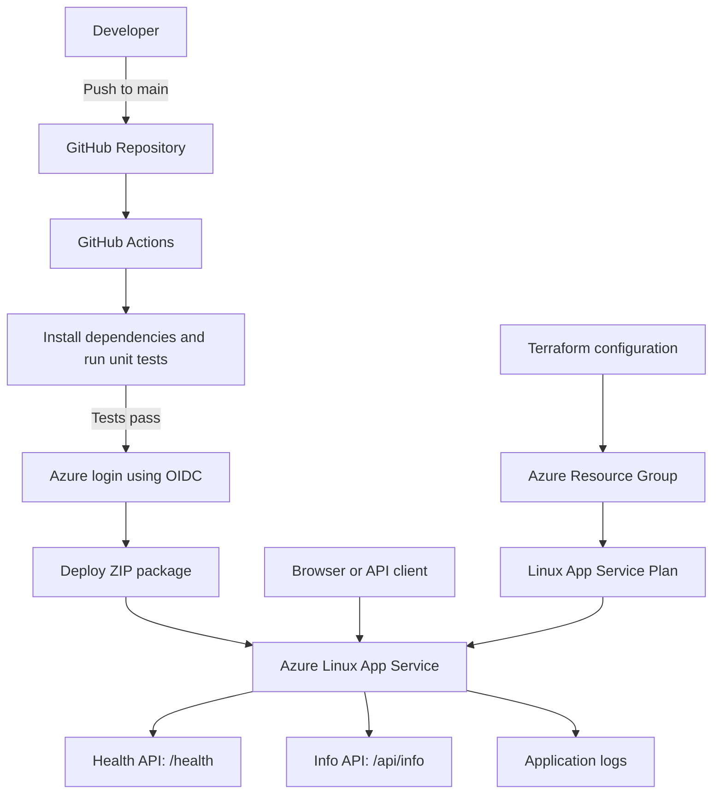
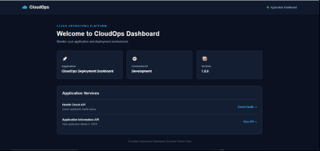
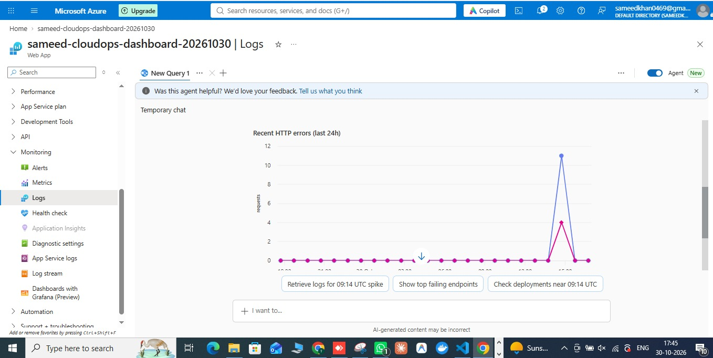
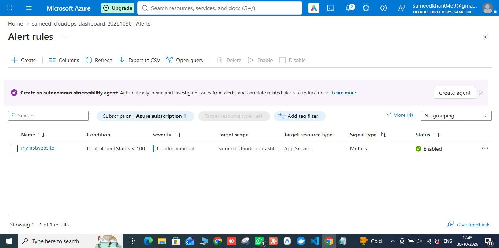

# CloudOps Deployment Dashboard

A Python Flask application deployed on **Microsoft Azure App Service (Linux)**. This project demonstrates cloud infrastructure provisioning with Terraform, automated testing, GitHub Actions CI/CD, secure Azure authentication using OpenID Connect (OIDC), health-check APIs, application logging, and Azure monitoring.

<p align="center">
  <a href="https://sameed-cloudops-dashboard-20261030.azurewebsites.net"><strong>🚀 Open Live Dashboard</strong></a>
  &nbsp; • &nbsp;
  <a href="https://github.com/Sameedkhan469/Cloudops-Deployment-Dashboard">Source Code</a>
</p>

## Project Overview

| Area | What this project includes |
|---|---|
| **Application** | Python Flask web dashboard |
| **Cloud platform** | Microsoft Azure App Service on Linux |
| **Infrastructure as Code** | Terraform provisions the Azure resource group, App Service Plan, and Web App |
| **CI/CD** | GitHub Actions runs tests and deploys successful pushes to `main` |
| **Authentication** | GitHub Actions connects to Azure using OpenID Connect (OIDC) |
| **Monitoring** | Azure App Service logs and Azure Monitor alert rules |
| **APIs** | `/health` for health status and `/api/info` for application details |

### Open the application

- **Web dashboard:** [sameed-cloudops-dashboard-20261030.azurewebsites.net](https://sameed-cloudops-dashboard-20261030.azurewebsites.net)
- **Health check:** [`/health`](https://sameed-cloudops-dashboard-20261030.azurewebsites.net/health)
- **Application information:** [`/api/info`](https://sameed-cloudops-dashboard-20261030.azurewebsites.net/api/info)

The web dashboard displays the application name, environment, version, and links to the API endpoints.

## Architecture



Terraform provisions the Azure infrastructure. GitHub Actions handles application testing and deployment; the workflow does not run Terraform.

## Application Dashboard Preview

### Dashboard Preview

<p align="center">
  
</p>

[Open the live dashboard](https://sameed-cloudops-dashboard-20261030.azurewebsites.net)

## Azure Deployment Screenshots

These screenshots show the Azure App Service monitoring configuration. They are Azure portal screenshots, not screenshots of the Flask web dashboard.

### 1. Azure App Service – Log Stream

This view shows the Azure App Service Logs interface and HTTP error monitoring.



[Open full-size Azure Log Stream screenshot](screenshots/azure-logs.jpg)

### 2. Azure Monitor – Alert Rules

This view shows the configured Azure Monitor alert rule, its condition, target resource, signal type, and enabled status.



[Open full-size Azure Alert Rules screenshot](screenshots/azure-alerts.jpg)

## Technologies

- **Application:** Python 3.14, Flask, Gunicorn
- **Frontend:** HTML5, CSS3
- **Cloud:** Microsoft Azure App Service (Linux)
- **Infrastructure as Code:** Terraform, AzureRM provider
- **CI/CD:** GitHub Actions
- **Authentication:** GitHub Actions OIDC with Microsoft Entra ID
- **Testing:** Python `unittest`
- **Source control:** Git and GitHub

## Features

- Web dashboard with application name, version, and environment
- Health-check endpoint at `/health`
- Application information endpoint at `/api/info`
- Python application logging for dashboard and API requests
- Automated unit tests
- GitHub Actions workflow that tests changes and deploys successful pushes to `main`
- Azure App Service deployment without Docker
- Azure App Service log monitoring
- Azure Monitor alert rule configuration

## Azure Infrastructure

Terraform configuration in `main.tf` defines these resources:

| Resource | Name / Configuration |
|---|---|
| Resource group | `sam-cloudops-rg` |
| Location | Central India |
| Linux App Service Plan | `sam-cloudops-plan` |
| App Service Plan SKU | F1 |
| Linux Web App | `sameed-cloudops-dashboard-20261030` |
| Runtime | Python 3.14 |
| HTTPS | Enabled |

The F1 plan is a free tier with usage and capability limits. Check current Azure pricing and quotas before changing tiers or adding services.

## Project Structure

```text
azure/
├── .github/
│   └── workflows/
│       └── ci.yml
├── screenshots/
│   ├── azure-logs.jpg
│   └── azure-alerts.jpg
├── static/
│   └── style.css
├── templates/
│   └── index.html
├── tests/
│   ├── __init__.py
│   └── test_app.py
├── app.py
├── main.tf
├── .terraform.lock.hcl
├── requirements.txt
├── .gitignore
└── README.md
```

Local-only files such as `.venv/`, `.terraform/`, Terraform state files, local variable files, and deployment ZIP files are excluded from Git.

## Run Locally

Create and activate a virtual environment in Git Bash:

```bash
python -m venv .venv
source .venv/Scripts/activate
```

Install dependencies and start the Flask application:

```bash
python -m pip install -r requirements.txt
python app.py
```

Open [http://127.0.0.1:5000](http://127.0.0.1:5000) in your browser.

## API Endpoints

| Endpoint | Purpose |
|---|---|
| `/` | Main dashboard |
| `/health` | Returns application health status and version |
| `/api/info` | Returns application name, version, and environment |

Example health-check response:

```json
{
  "status": "healthy",
  "application": "CloudOps Deployment Dashboard",
  "version": "1.0.0"
}
```

## Run Automated Tests

```bash
python -m unittest discover -s tests -p "test*.py" -v
```

## CI/CD Pipeline

The workflow is defined in `.github/workflows/ci.yml`.

1. A push to `main` or a pull request targeting `main` triggers the test job.
2. GitHub Actions checks out the repository, sets up Python, installs dependencies, and runs unit tests.
3. For a push to `main`, if tests pass, the deployment job starts.
4. GitHub Actions authenticates to Azure using OIDC and the `production` GitHub Environment secrets.
5. The workflow packages the Flask application and deploys it to Azure App Service.

Pull requests run tests but do not deploy. Azure authentication uses OIDC rather than a long-lived client secret.

## Terraform

The `main.tf` file provisions the resource group, Linux App Service Plan, and Linux Web App. The Azure subscription ID is supplied through the `TF_VAR_subscription_id` environment variable and is not stored in the configuration.

Example Git Bash commands:

```bash
export TF_VAR_subscription_id="YOUR_AZURE_SUBSCRIPTION_ID"
terraform init
terraform fmt
terraform validate
terraform plan
```

Review the plan carefully before running `terraform apply`. Applying this configuration in a fresh Terraform working directory can create Azure resources and may incur charges. Terraform state is not committed to this repository; keep state files private and backed up.

## Monitoring and Logs

Application logs are enabled for the Azure App Service. The Flask application writes informational messages when the dashboard, health-check endpoint, and application information endpoint are requested.

In the Azure Portal, open the Web App and select **Monitoring → Log stream** to view live application output.

Azure Monitor alert rules can be configured to monitor application conditions and notify administrators when defined thresholds are met.

## Security Notes

- GitHub Actions uses OIDC to authenticate to Azure.
- Azure deployment credentials are stored as GitHub Environment secrets, not in source code.
- Do not commit `.env`, `*.tfvars`, Terraform state files, access tokens, passwords, or private keys.
- The subscription ID is passed to Terraform through an environment variable.

## Future Improvements

- Add additional Azure Monitor alerts for application availability and failures.
- Add monitoring dashboards with request and error metrics.
- Improve application performance monitoring.
- Add automated deployment notifications.
