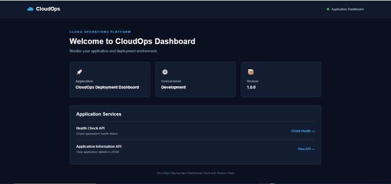
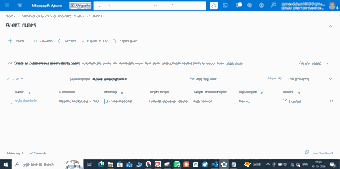

# CloudOps Deployment Dashboard

A Python Flask application deployed to Microsoft Azure App Service. This project demonstrates infrastructure provisioning with Terraform, automated testing, GitHub Actions CI/CD, secure Azure authentication with OpenID Connect (OIDC), health-check APIs, and application logging.

**Live application:** https://sameed-cloudops-dashboard-20261030.azurewebsites.net  
**GitHub repository:** https://github.com/Sameedkhan469/Cloudops-Deployment-Dashboard

## Architecture

```mermaid
flowchart TD
    Dev[Developer] -->|Push to main| GH[GitHub Repository]
    GH --> CI[GitHub Actions]
    CI --> Tests[Install dependencies and run unit tests]
    Tests -->|Pass| OIDC[Azure login using OIDC]
    OIDC --> Deploy[Deploy ZIP package]
    Deploy --> App[Azure Linux App Service]
    User[Browser or API client] --> App
    App --> Health[/health]
    App --> Info[/api/info]
    App --> Logs[Application logs]
    TF[Terraform configuration] --> RG[Azure Resource Group]
    RG --> Plan[Linux App Service Plan]
    Plan --> App
```

Terraform is used to provision the Azure infrastructure. GitHub Actions handles application testing and application deployment; the workflow does not run Terraform.

## Screenshots

### CloudOps dashboard



### Azure App Service Log stream


### Azure alert rules



### GitHub Actions CI/CD

The latest verified pipeline run completed successfully, including Python tests and deployment to Azure App Service.

[View successful GitHub Actions run #5](https://github.com/Sameedkhan469/Cloudops-Deployment-Dashboard/actions/runs/41051267566)

> The original GitHub Actions success-run screenshot has not been added yet. This link opens the actual successful run; the screenshot can be added when provided.

## Technologies

- **Application:** Python 3.14, Flask, Gunicorn
- **Frontend:** HTML5, CSS3
- **Cloud:** Microsoft Azure App Service (Linux)
- **Infrastructure as Code:** Terraform, AzureRM provider
- **CI/CD:** GitHub Actions
- **Authentication:** GitHub Actions OIDC with Microsoft Entra ID
- **Testing:** Python `unittest`
- **Source control:** Git and GitHub

## Features

- Web dashboard with application name, version, and environment
- Health-check endpoint at `/health`
- Application information endpoint at `/api/info`
- Python application log messages for dashboard and API requests
- Automated unit tests
- GitHub Actions workflow that tests changes and deploys successful pushes to `main`
- Azure App Service deployment without Docker

## Azure Infrastructure

Terraform configuration in `main.tf` defines these resources:

| Resource | Name / configuration |
|---|---|
| Resource group | `sam-cloudops-rg` |
| Location | Central India |
| Linux App Service Plan | `sam-cloudops-plan` |
| App Service Plan SKU | F1 |
| Linux Web App | `sameed-cloudops-dashboard-20261030` |
| Runtime | Python 3.14 |
| HTTPS | Enabled |

The F1 plan is a free tier with usage and capability limits. Check current Azure pricing and quotas before changing tiers or adding services.

## Project Structure

```text
azure/
├── .github/
│   └── workflows/
│       └── ci.yml
├── docs/
│   └── screenshots/
│       ├── dashboard.png
│       ├── azure-logs.png
│       └── azure-alerts.png
├── static/
│   └── style.css
├── templates/
│   └── index.html
├── tests/
│   ├── __init__.py
│   └── test_app.py
├── app.py
├── main.tf
├── .terraform.lock.hcl
├── requirements.txt
├── .gitignore
└── README.md
```

Local-only files such as `.venv/`, `.terraform/`, Terraform state files, local variable files, and the deployment ZIP are excluded from Git.

## Run Locally

Create and activate a virtual environment in Git Bash:

```bash
python -m venv .venv
source .venv/Scripts/activate
```

Install the dependencies and start the Flask app:

```bash
python -m pip install -r requirements.txt
python app.py
```

Open http://127.0.0.1:5000 in your browser.

## API Endpoints

| Endpoint | Purpose |
|---|---|
| `/` | Main dashboard |
| `/health` | Returns application health status and version |
| `/api/info` | Returns application name, version, and environment |

Example health-check response:

```json
{
  "status": "healthy",
  "application": "CloudOps Deployment Dashboard",
  "version": "1.0.0"
}
```

## Run Automated Tests

```bash
python -m unittest discover -s tests -p "test*.py" -v
```

## CI/CD Pipeline

The workflow is defined in `.github/workflows/ci.yml`.

1. A push to `main` or pull request targeting `main` triggers the test job.
2. GitHub Actions checks out the repository, sets up Python, installs dependencies, and runs the unit tests.
3. For a push to `main`, if tests pass, the deployment job starts.
4. GitHub Actions authenticates to Azure using OIDC and the `production` GitHub Environment secrets.
5. The workflow packages the Flask application and deploys it to Azure App Service.

Pull requests run tests but do not deploy. Azure authentication uses OIDC rather than a long-lived client secret.

[View the latest verified successful CI/CD run](https://github.com/Sameedkhan469/Cloudops-Deployment-Dashboard/actions/runs/41051267566).

## Terraform

The `main.tf` file provisions the resource group, Linux App Service Plan, and Linux Web App. The Azure subscription ID is supplied through the `TF_VAR_subscription_id` environment variable and is not stored in the configuration.

Example Git Bash commands:

```bash
export TF_VAR_subscription_id="YOUR_AZURE_SUBSCRIPTION_ID"
terraform init
terraform fmt
terraform validate
terraform plan
```

Review the plan carefully before running `terraform apply`. Applying this configuration in a fresh Terraform working directory can create Azure resources and may incur charges. Terraform state is not committed to this repository; keep state files private and backed up.

## Monitoring and Logs

Application logs are enabled for the Azure App Service. The Flask app writes informational messages when the dashboard, health-check endpoint, and application information endpoint are requested.

In the Azure Portal, open the Web App and select **Monitoring → Log stream** to view live application output. The repository also includes a screenshot of the existing enabled health-check metric alert; it is not an HTTP 5xx alert.

## Security Notes

- GitHub Actions uses OIDC to authenticate to Azure.
- Azure deployment credentials are stored as GitHub Environment secrets, not in source code.
- Do not commit `.env`, `*.tfvars`, Terraform state files, access tokens, passwords, or private keys.
- The subscription ID is passed to Terraform through an environment variable.

## Future Improvements

- Add Azure Monitor alerts for application availability and server errors.
- Add a real GitHub Actions run screenshot to the screenshots folder.
- Add a monitoring view with request and error metrics.
